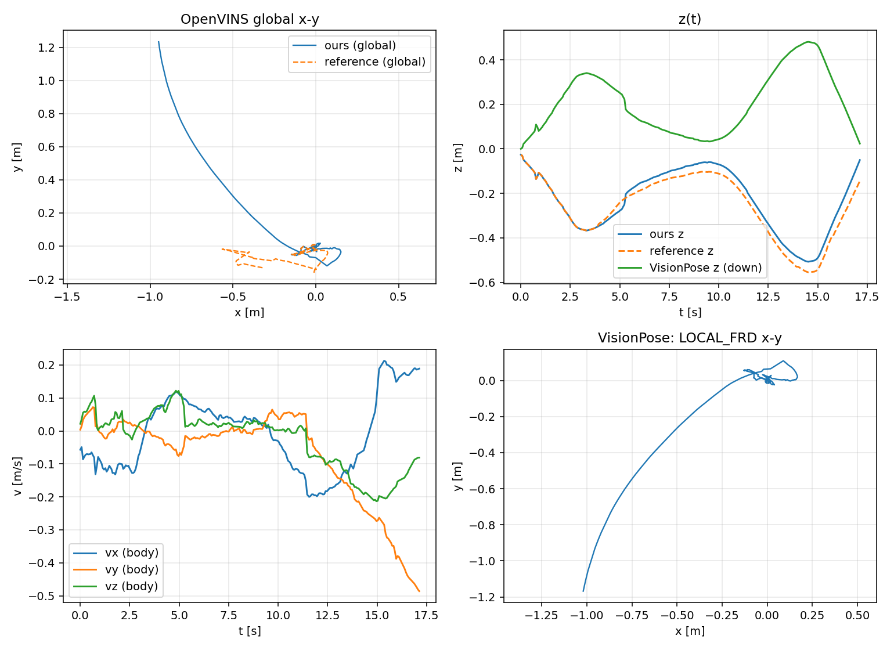

# session05 离线验证记录

日期：2026-10-18
程序：`~/calib/vio_online`（ROS-free OpenVINS v2.7.0 + VisionPose 转换）
数据：`~/calib/rosbags/session05.bag`（479 帧 1920×1080 mono8，4728 帧 IMU @ 200 Hz）

---

## 1. 命令

```bash
# 1) bag → 数据集
source ~/miniforge3/etc/profile.d/conda.sh && conda activate vins
cd ~/calib/vio_online
python tools/bag_to_dataset.py \
    --bag ~/calib/rosbags/session05.bag \
    --out ~/calib/datasets/session05

# 2) 回放
./build/bin/vio_offline \
    --dataset ~/calib/datasets/session05 \
    --config-dir config/session05_1920x1080 \
    --csv-out out/session05_pose.csv \
    --tum-out out/session05_traj.tum \
    --raw-tum-out out/session05_raw.tum

# 3) 与 OpenVINS ROS1 参考轨迹对比
python tools/compare_traj.py out/session05_raw.tum ~/calib/vio_out/session05.txt --tol 0.02
```

配置与参考跑（`~/calib/ov_config_session05`）完全一致：

- IMU 噪声：`gyro 1.57e-3`、`accel 2.5e-3`、`bg 1e-5`、`ba 3e-4`
- 外参/时移：`session05_window`，`timeshift_cam_imu = -0.0147307 s`
- `track_frequency = 21`（复刻 ROS 节点的图像降频）
- `init_dyn_use = true`，`use_stereo = false`，`calib_cam_* = false`

---

## 2. VisionPose 自检

见 `validation_session05.txt`（同目录）。关键项：

| 检查 | 结果 |
|---|---|
| 帧数 / 频率 | 217 帧 / 12.67 Hz（受 `track_frequency=21` + 图像间隔限制） |
| `frame_id` / `child_frame_id` | 20 (`LOCAL_FRD`) / 12 (`BODY_FRD`) |
| 时间戳单调 | ✅ |
| `p(0)` | `(0, 0, 0)` |
| `q` 范数 | `[0.999999961, 1.000000034]` |
| q 符号连续 | ✅ |
| 首帧 IMU 加速度在 LOCAL_FRD | `(0.053, 0.056, -9.709)` → 重力沿 -z ✅ |
| 首帧时间戳 | 图像时间 + `timeshift_cam_imu`（差 -14.731 ms，配置 -14.731 ms）✅ |
| 速度一致性（v_body→LOCAL_FRD vs dp/dt） | mean 0.037 m/s，max 0.62 m/s |
| 轨迹长度 | 3.248 m |

> session05 是手持标定数据，初始化时设备姿态任意，所以首帧 q 不是单位四元数；
> 这里检查的是“重力方向”，不是 q≈I。

---

## 3. 与 OpenVINS ROS1 参考轨迹对比

```
匹配帧: 217/217 (tol=0.02s), 时间范围 [1792118700.682, 1792118717.812]
  位置差 (m)       : mean=0.1714  median=0.0724  p95=0.9093  max=1.5074
  姿态差 (deg)     : mean=0.7349  median=0.5174  p95=2.4710  max=2.9067
  时间差 (ms)      : mean=0.00  max=0.01
  A 轨迹长度       : 3.248 m
  B 轨迹长度       : 2.650 m
```

- 时间戳逐帧一致（0.00 ms）；
- 第一帧位置/姿态完全一致；
- 轨迹有界、形状一致，但末端差 1.5 m（参考 2.65 m 路径）。

参考轨迹自身重复性（`repeat_r1.txt` vs `session05.txt`）：position diff mean
**2.18×10⁻⁵ m**，max 1.94×10⁻⁴ m —— 同一套编译环境内几乎逐帧重合。

因此 0.17 m 的差异不是数据/配置/时间戳问题，而是**数值实现差异**被 VIO 放大：

- 系统 OpenCV **4.5.4**（本工程）vs conda OpenCV **4.10.0**（参考轨迹）；
- 图像逐像素一致、IMU 数据一致、时间戳一致；
- 偏差从 1e-6 m 量级开始，3.5 s 后到 1 mm，随后逐渐放大。

结论：**管线与坐标系转换正确**；若要求与参考逐帧重合，应在完全相同的第三方库
版本下编译。对实际飞行而言，更重要的是真机数据上的稳定性和飞控融合效果。

---

## 4. 图



- 左上：OpenVINS global x-y（本工程 vs 参考）
- 右上：z(t)（global z-up；绿色是 VisionPose 的 LOCAL_FRD z，向下为正）
- 左下：VisionPose 输出的机体系速度
- 右下：VisionPose 的 LOCAL_FRD x-y

---

## 5. 环境

| 项目 | 版本 |
|---|---|
| OS | Ubuntu 22.04.5 |
| GCC | 11.4.0 |
| CMake | ≥ 3.16 |
| Eigen | 3.4.0 |
| OpenCV | 4.5.4（系统） |
| Boost | 1.74.0 |
| Ceres | 2.0.0 |
| OpenVINS | v2.7.0（`~/vio_ws/src/open_vins`，ROS-free 裁剪） |
