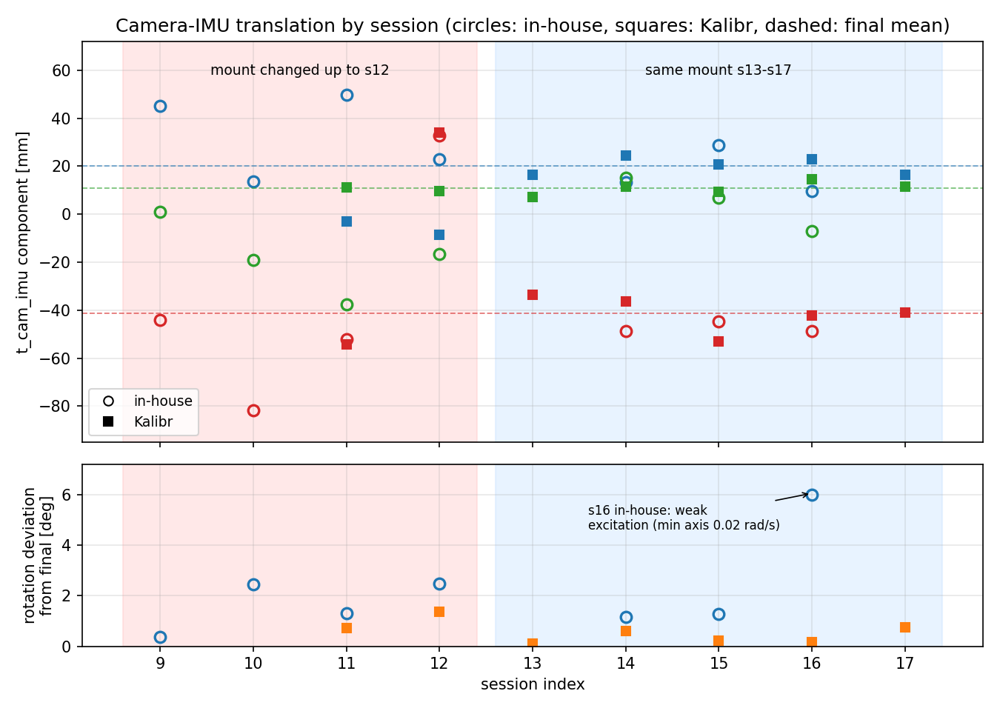

# 相机–IMU 外参标定：最终结论

日期：2026-10-19　　工作目录：`~/calib/camera_imu_calibration`

---

## 0. 一句话结论

两份结果**都没算错**，但 **Kalibr 那份更可信**；把 s13–s17（同一安装状态）的 Kalibr
结果做旋转平均 + 平移/时偏取中位数，就是最终外参。

自研工具在 s14/s15（激励足够的两段）上的结果与最终值只差 **0.66° / 5.5 mm / 12 ms**，
说明两者并不矛盾——主要差别是自研工具**选窗太短、激励不足、时间偏移不稳**。

另外：你的判断是对的。s12 及以前安装状态不同，**跨 session 纵向比较没有意义**；
s12→s13 之间 IMU 相对相机的 z 平移从 **+33.9 mm** 跳到 **−33.5 mm**，两种方法**同时**
看到这个跳变（见表 2），这是一次真实的重装，不是算法噪声。

最终外参文件：

| 文件 | 用途 |
|---|---|
| `final/extrinsics-final-camchain.yaml` | Kalibr 格式（`T_cam_imu` + `timeshift_cam_imu`） |
| `final/camchain-openvins-final.yaml` | OpenVINS 格式（`T_imu_cam` + `timeshift_cam_imu`） |
| `final/kalibr_imucam_chain.yaml` | 同上，可直接替换 OpenVINS 配置里的同名文件 |
| `final/imu-final.yaml` | 实测 IMU 噪声（Kalibr/OpenVINS 通用） |
| `final/extrinsics_by_session.png` | 逐 session 平移/旋转对比图 |

---

## 1. 这台电脑能不能跑（2026-10-19 实测）

| 项目 | 实测值 | 结论 |
|---|---|---|
| CPU | Intel Core Ultra 7 255HX，20 线程 | 够用，Kalibr 是单/多线程 CPU 计算 |
| 内存 | 15 GiB（空闲 9 GiB） | 够用 |
| 磁盘 | 192 GB，剩 **51 GB** | 够用：一个 session 的 bag ≈ 1.2 GB；7 个全留 ≈ 8.5 GB |
| GPU | NVIDIA 驱动不可用 | **不需要**，Kalibr 不用 GPU |
| Docker | 29.1.3，`kalibr:latest` 镜像 8.11 GB | 已就绪 |
| Conda 环境 | `vins`：Python 3.11.16 / OpenCV 4.10 / numpy 1.26.4 / scipy 1.17.1 / rosbags | 已就绪 |
| 单 session 耗时 | 打 bag + Kalibr 约 **3–6 min** | 可接受 |

两个必须知道的坑：

1. **必须用 `conda activate vins` 的 Python 3.11。** 系统自带 `python3` 是 OpenCV 4.5.4，
   对同一张图 **0 个 AprilTag**；vins 里的 OpenCV 4.10 能检出 **36 个**。
2. **不需要 X display。** 收尾报 `Unable to access the X Display` 只是画 PDF 那步的警告，
   yaml 已经生成；`kalib/run_kalibr.py` 已设 `MPLBACKEND=Agg`。

---

## 2. 安装时间线：为什么只能平均 s13–s17

用两种方法各自估计的 `t_cam_imu`（IMU 原点在相机系下的坐标，mm）和旋转偏差：

| session | 自研 t [mm] | Kalibr t [mm] | 说明 |
|---|---|---|---|
| 03–05 | 旋转与后续差 **176.6°–180.0°** | — | 相机相对 IMU 转了约 180°，完全不同安装 |
| 09 | `[45.1, 1.1, -44.0]` | — | 旋转回到"正常"，但平移仍在变 |
| 10 | `[13.5, -19.1, -81.6]` | — | z 差 40 mm |
| 11 | `[49.8, -37.6, -52.1]` | `[-2.9, 11.0, -54.3]` | 两种方法互相差 40 mm，仍在变化 |
| **12** | `[22.8, -16.5, +32.7]` | `[-8.7, 9.8, +33.9]` | **z 变号，重装**（两边同时看到） |
| 13 | — | `[16.4, 7.3, -33.5]` | 进入同一安装 |
| 14 | `[13.2, 15.1, -48.8]` | `[24.3, 11.6, -36.2]` | 同一安装 |
| 15 | `[28.7, 6.8, -44.6]` | `[20.6, 9.3, -53.1]` | 同一安装 |
| 16 | `[9.6, -6.9, -48.6]` | `[22.9, 14.5, -42.2]` | 同一安装（自研这次激励不足，见 §4.4） |
| 17 | — | `[16.4, 11.4, -41.0]` | 同一安装 |

**结论**：s03–s05、s09–s12 各自是不同安装；**s13–s17 是同一安装**，只有这 5 段可以互相平均。
你的话和数据完全对上。



---

## 3. 同 session 对比（唯一公平的比较）

同一段数据、同一内参、同一靶标，只有算法不同：

| session | 旋转差 | 平移差 | 平移差分量 dx/dy/dz | 时偏差 |
|---|---:|---:|---|---:|
| s12 | 1.39° | 41.0 mm | +31.5 / −26.2 / −1.2 | +0.8 ms |
| s14 | 0.75° | 17.2 mm | −11.1 / +3.5 / −12.6 | +2.3 ms |
| s15 | 1.10° | 12.0 mm | +8.1 / −2.6 / +8.5 | +24.8 ms |
| s16 | 5.85° | 26.0 mm | −13.3 / −21.4 / −6.4 | +9.2 ms |

s14/s15 这种激励足够的段，两种方法只差 **0.75°–1.10° / 12–17 mm**；s16 差 5.85°，
原因见 §4.4（自研那一段只有一根轴被激励起来）。

---

## 4. 为什么判 Kalibr 更可信：四条独立证据

### 4.1 同一安装下的重复性（最关键）

s13–s17 五次独立录制，理论上应给同一个外参。两两之间的散布：

| 指标（两两差的中位数 / 范围） | **Kalibr s13–17** | 自研 s14–16 |
|---|---:|---:|
| 旋转 | **0.64° / 0.14–1.35°** | 6.05° / 2.06–6.75° |
| 平移 | **10.8 mm / 6.8–20.1 mm** | 22.3 mm / 18.1–23.8 mm |
| 时间偏移 | **3.5 ms / 0.5–7.5 ms** | 14.4 ms / 12.0–26.4 ms |

旋转重复性差 **约 10 倍**，时偏差 **约 4 倍**。这不是"谁更接近真值"的直接证明，
但同一台设备、同一块板、同一安装，**自洽性**是最硬的指标；Kalibr 的分散度已小于
你后续做 VIO 能感知的量级。

### 4.2 时间偏移：物理约束 + 时间戳实验

- `images.csv` 里的相机时间是**宿主收到图像的时间**，比 V4L2 驱动给的
  start-of-exposure 时间晚 **28.0 ms**（中位；p5 = 28.0 ms，跨 session 稳定）；
  曝光设的是 200（20 ms）。也就是说相机时间戳**系统性偏晚**，正确时偏必然是负的、
  量级十几毫秒。
- Kalibr 在 s13–s17 上用宿主时间戳得到 **−11.7 … −19.2 ms（中位 −15.8）**；7 段全算 −11.7 … −26.6 ms。自研得到
  **−27.2 … +9.4 ms**。s15 的 **+9.4 ms** 意味着"相机在曝光之前就收到了图"，
  物理上不成立。
- 我做了个对照实验：用 V4L2 驱动时间戳（换算到宿主实时时基）重打 s16 的 bag 再跑 Kalibr，
  时偏变成 **+18.17 ms**（换算回宿主时间 = **−9.85 ms**），与宿主版 **−11.73 ms**
  只差 **1.9 ms**；外参旋转变化 < 0.1°，平移变 10 mm，重投影残差 **完全不变**
  （11.42 vs 11.45 px）。→ Kalibr 的时偏估计**对时间戳约定不敏感、自洽**。

### 4.3 用了多少数据、怎么加权

| | Kalibr | 自研 |
|---|---|---|
| 参与拟合的帧 | **582–584**（全部，19.45 s） | 46–165（**8%–29%**，5.4–15.3 s） |
| 陀螺权重 σ | 8.6×10⁻⁴ rad/s（离散） | 1.0×10⁻² rad/s（**弱 11.6×**） |
| 加计权重 σ | 6.0×10⁻³ m/s² | 1.0×10⁻¹ m/s²（**弱 16.6×**） |

自研把 IMU 权重压低 12–17 倍，自然会更贴相机、重投影更小；这是**权衡选择**，
不是精度更高。

### 4.4 自研 s16 是"该被拒绝却通过"的（代码 bug）

s16 的角速度标准差奇异值是 `[0.165, 0.122, **0.0197**]` rad/s —— 最弱那根轴只有
0.020 rad/s，低于配置的 `min_rotation_std_rad_s = 0.05`。但 `calib/solver.py:134` 检查的是
**`singular[1]`**（0.122）而不是 **`singular[2]`**（0.0197），于是放行，结果旋转偏了 6°。
建议把该行改成检查 `singular[2]`（或加条件数检查）。这是自研工具唯一一个真正需要修的
实质问题，其余是参数选择。

### 4.5 为什么自研的 1.5 px 重投影不代表外参更准

1. **平面靶的姿态歧义**（实测）：同一条自研样条位姿把角点重投影到 **1.60 px**，
   逐帧 PnP 位姿重投影 **2.37 px**，但两者的**相对旋转差 1.8 倍**。
   原因是平面靶上"绕面内轴转一点 + 沿光轴平移一点"几乎不改变成像——所以
   **重投影小 ≠ 旋转对**。这时只能靠 IMU 定旋转，而自研恰好把 IMU 权重压低了。
2. **Kalibr 的 11 px 是另一回事**：它不是随机噪声——PDF 里的重投影误差呈**四瓣状**、
   7 个 session 几乎不变（10.3–12.4 px），说明是**固定的模型/靶标问题**（靶标几何或
   rolling-shutter/模糊），不是时间不同步（换了时间戳方案后它一点没变）。
   同一套内参在**打印棋盘格**（8×11、3 cm）上验到 **0.440 px / 70 张图 / 9 个 3×3 区域全覆盖**，
   所以内参本身没问题——11 px 更可能是 AprilGrid 的靶标几何/角点约定问题
   （具体原因要卡尺复量 tag 边长/间隙才能确认，见 §6 第 4 条）。
3. 这个 11 px 主要削弱**平移**的可信度（§5 的不确定度已按此放宽），不改变
   "用 Kalibr 这份"的选择。

---

## 5. 最终外参（s13–s17 的 Kalibr 结果平均）

约定（两份 yaml 一致）：

```
p_C = T_cam_imu · p_I          T_imu_cam = inverse(T_cam_imu)
t_imu = t_cam + timeshift_cam_imu
```

### 5.1 `T_cam_imu`（IMU → 相机）

```
[[ 0.00155302  0.99996895 -0.00772629   0.02012777]
 [ 0.03539396 -0.00777642 -0.99934318   0.01081114]
 [-0.99937223  0.00127854 -0.03540493  -0.04120369]
 [ 0          0           0            1        ]]
```

平移 = **[20.1, 10.8, −41.2] mm**（|t| = 47.1 mm）。

### 5.2 `T_imu_cam`（相机 → IMU，OpenVINS 用）

```
[[ 0.00155302  0.03539396 -0.99937223  -0.04159173]
 [ 0.99996895 -0.00777642  0.00127854  -0.01999039]
 [-0.00772629 -0.99934318 -0.03540493   0.00950074]
 [ 0          0           0            1        ]]
```

### 5.3 时间偏移

**`timeshift_cam_imu = −15.84 ms`**（s13–s17：−16.51 / −19.21 / −15.38 / −11.73 / −15.84，中位 −15.84）。

注意：这个值是相对**当前 `images.csv` 里的宿主接收时间**的。如果你以后改用 V4L2
驱动时间戳（start-of-exposure）打 bag，要把它换算成 **+18.2 ms**（= −15.84 + 28.0，
见 §4.2 的对照实验；s16 实测 +18.17 ms）。

### 5.4 内参（未改动，用已验证的那份）

```
fx, fy, cx, cy = 1367.4658, 1367.6342, 971.4602, 550.6220
radtan = [0.089645, -0.148418, -0.000893, 0.000788]
resolution = 1920 × 1080
```

### 5.5 不确定度（诚实版）

| 量 | 1σ 估计 | 依据 |
|---|---|---|
| 旋转 | **±0.7°** | 5 段相对平均 0.11–0.76°；与自研(14/15) 差 0.66° |
| 平移 | **±8 mm**（z 向 ±7 mm） | 逐段标准差 3.3/2.4/6.7 mm；与自研(14/15) 差 5.5 mm；Kalibr 11 px 残差额外放大 |
| 时偏 | **±4 ms** | 5 段标准差 2.4 ms；时间戳约定差 1.9 ms；与自研差 12 ms（以 Kalibr 为准） |

一句话：**旋转可以放心用（<1°）；平移是 ±1 cm 量级**（杠杆臂本身才 47 mm，
所以相对不确定度不小，这是这套数据/靶标的固有限制，不是哪个算法算错）。

### 5.6 交叉验证

自研 s14+s15 平均：`t = [20.9, 10.9, −46.7] mm`，时偏 −3.8 ms。
与最终值差 **0.66° / 5.5 mm / 12 ms**。也就是说：**换一份结果，旋转和平移的变化
都在上面的不确定度之内**——真正的不确定性来自数据本身，不是"选哪一份"。

---

## 6. 怎么用 / 下次怎么做得更好

**用**：

- OpenVINS 直接吃 `final/camchain-openvins-final.yaml`（`T_imu_cam` + `timeshift_cam_imu`）
  和 `final/imu-final.yaml`；也可以把 `final/kalibr_imucam_chain.yaml` 直接替换到现有
  OpenVINS 配置目录里（文件名就是 OpenVINS 认的那个）。
- ⚠️ **不要再用 `ov_config_session05/kalibr_imucam_chain.yaml` 里的外参**——那是旧安装
  （z 平移 +148 mm，旋转也完全不同），和现在的机械状态对不上。

**下次重录（想把 ±8 mm 压下去）**：

1. 曝光 200（20 ms）在快速转动时会把 tag 边缘拖糊：**先把曝光降到 150→100，或补光**，
   让白格 p90 落在 60–150；
2. 动作慢一点、平滑一点（约 30°/s），**整块板全程留在画面**，多轴都转起来；
3. 录 20–30 s，**别只截 5 s**——自研工具的问题就是自动选窗选到了激励不足的段；
4. 用卡尺**复量 tag 边长与间隙**（Kalibr 的四瓣残差在提示靶标几何可能和配置对不上）；
5. 每次只标一段，**别跨安装混**；s12 及以前的任何结果都不能和现在的机械状态混用。

---

## 附：证据文件

| 文件 | 内容 |
|---|---|
| `analysis/compare_all.py` | 两种方法的逐 session 对比脚本 |
| `analysis/time_offset_scan.py` | 用图像旋转率独立检验时偏的脚本（结论：平面靶有姿态歧义，单靠它不能定论） |
| `analysis/final_agg.json` / `final/final_extrinsics.json` | 最终外参的原始数值与统计 |
| `analysis/run_session16_v4l2.log` | 驱动时间戳对照实验的完整日志 |
| `kalib/results/session16_v4l2/` | 对照实验的 Kalibr 输出 |
| `kalib/results/session1X/` | 各 session 的 Kalibr 原始结果 |
| `results/session1X/` | 各 session 的自研原始结果与 report.json |
